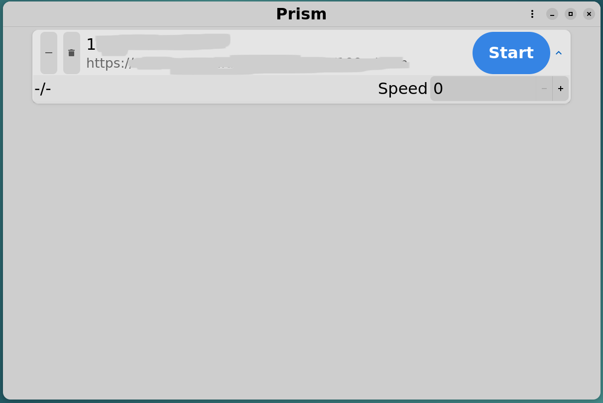

# Prism

A simple download manager for Linux.

Requires:
- python3
- Gtk4 (Adwaita widgets)
- pycurl

Features:
- download speed
- interrupted downloads can be resumed (if supported by the source).
- tracks the downloaded size and the total size (when this is possible).

